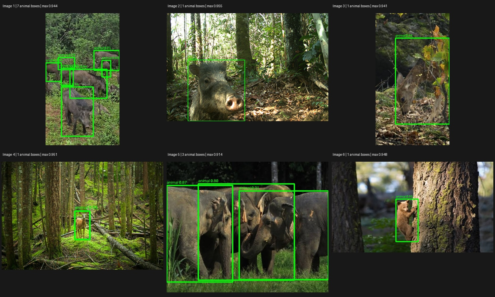

# WildPulse

WildPulse is a camera-trap wildlife detection project. It runs MegaDetector on a small set of images and saves the boxes, confidence scores, annotated previews, and time taken for each image.

The first working baseline uses SPARROW-Engine on a Google Colab CPU runtime. Six images have been processed successfully. This is the starting point for reviewing detections and measuring performance on a larger dataset.

## Detection previews

Real model outputs from Trial 5 at confidence 0.5. Green boxes show predicted animal locations, including small, partly hidden and grouped subjects.



These previews show image detection. Identity tracking between frames is not implemented. Overlapping boxes in group photos are not verified animal counts, and confidence scores are not accuracy measurements.

## What it does

- **Processes each image independently.** Every image gets its own detection record and wall-clock timing.
- **Shows what the model found.** Annotated previews put boxes around predicted animals, people, and vehicles.
- **Saves usable results.** Outputs include a detailed JSON summary, MegaDetector-format JSON, a CSV export, and a self-contained review page.
- **Records human review.** Mark outputs correct, incorrect or uncertain and add notes. Review exports reference the exact prediction file while leaving model outputs unchanged.
- **Separates startup from repeat calls.** The script records the model download or cache check, the first detection call, and the following six timed calls.
- **Keeps an engineering record.** Setup failures, fixes, observed results, and unresolved issues are recorded in the project logs.

## Stack

- Python 3.11 or newer; the observed Colab runtime used Python 3.13.18
- [SPARROW-Engine](https://github.com/microsoft/SPARROW-Engine), pinned to version 0.1.32
- MegaDetector V6, model `MDV6-yolov10-e`
- OpenCV for annotated image output
- Google Colab for the initial CPU run

## Setup

### Review your own images

[Open the image review notebook in Colab](https://colab.research.google.com/github/Shreyakb301/WildPulse/blob/main/WildPulse_Image_Review.ipynb). Run setup, upload JPEG or PNG images (or load the included public example), detect, and download the ZIP. Each detection run has a fresh output directory, so confidence can be changed and rerun without mixing results. Cancelled uploads and failed runs clear the previous download target. The ZIP contains previews, JSON and CSV, and excludes original uploads. Confidence 0.5 is a review default, not a deployment recommendation.

The workflow passed isolated checks for unreadable files, matching filenames with different extensions and output reuse. Six automated checks cover review-page safety, ZIP inclusion and notebook states including cancelled uploads, invalid file selection, repeated runs and failed-run download protection. Run them with `python3 -m unittest discover -s tests -v`. Its notebook has been syntax-checked for Python 3.11. Fresh Colab setup, real inference on one public example, preview generation and direct ZIP export were verified. The exported ZIP passed SHA256 and CRC checks locally. The public example has a pinned image checksum, and setup loads a fixed version of the reviewed runner. Automated file-picker upload and standard browser download were not confirmed; a direct link fallback is included for bundles up to 20 MB.

For an installed local environment:

```bash
python run_images.py /path/to/images /path/to/new_output --threshold 0.5
```

### Review the results

Extract the downloaded ZIP and open `review.html` in your browser. Each image has an annotated preview, an assessment selector and a notes field. Mark the model output **correct**, **incorrect** or **uncertain**. Unreadable images remain visible in the review list.

Click **Download review JSON** before closing or reloading the page. The exported `WildPulse_review.json` includes the checksum of the exact `results.json` being reviewed. Decisions stay in the page until downloaded; there is no automatic saving. The page works offline and does not alter model predictions. A visual assessment does not establish ground truth or automatically recalculate accuracy.

### Run in Google Colab

Place the project files under `/content/WildPulse` and upload the six JPEG images into `/content/WildPulse/sample_images`.

```python
%pip install -r /content/WildPulse/requirements-baseline.txt
```

Then run:

```python
!python /content/WildPulse/run_baseline_sparrow.py
```

The script expects exactly six files with the `.jpeg` extension. The initial experiment used Snapshot Kruger images with suffixes `IMAG0029`, `IMAG0030`, `IMAG0031`, `IMAG0042`, `IMAG0043`, and `IMAG0044`.

The first run needs an internet connection to download the model. Generated files are written to `/content/WildPulse/baseline_output`. Download them before resetting the Colab runtime; session storage is temporary.

### Run locally

Create a Python environment, install the dependencies, and put the six images in `sample_images` inside this project folder:

```bash
python3 -m venv .venv
source .venv/bin/activate
pip install -r requirements-baseline.txt
python run_baseline_sparrow.py --project-dir .
```

Image files and model weights are not included in this repository. The standalone script has been syntax-checked locally; the equivalent detection and export steps were executed in Colab.

## Baseline results

Observed in Trial 1 using CPU inference and a confidence threshold of `0.2`:

| Image | Predictions | Wall time |
| --- | --- | ---: |
| IMAG0029 | animal 0.979 | 17.181 s |
| IMAG0030 | animal 0.976 | 14.572 s |
| IMAG0031 | person 0.587; animal 0.301 | 15.705 s |
| IMAG0042 | no detections | 15.991 s |
| IMAG0043 | animal 0.299; animal 0.276 | 14.688 s |
| IMAG0044 | animal 0.408 | 14.933 s |

Mean warmed wall time was **15.51 seconds per image**. Model download took 48.23 seconds, and the first detection call took 15.20 seconds. The six-image run followed that first call and additional debugging calls; timings include image decoding and Python API overhead.

These labels are predictions. The person prediction and the lower-confidence animal boxes need review. Six images do not establish detection accuracy, throughput, or performance on other hardware. MegaDetector detects broad categories; it does not identify species.

## About the images

The initial images came from [Snapshot Kruger on LILA BC](https://lila.science/datasets/snapshot-kruger). Refer to the dataset page for source information, attribution, and usage terms before using or redistributing images. Model usage terms are separate; the downloaded model package identifies its license as AGPL-3.0.

## Engineering record

### New site evaluation

A separate Snapshot Enonkishu sample completed 64 images from 30 sequences across 16 cameras. At the threshold of 0.5 fixed before inference, all 15 animal-labeled sequences were detected and four empty-labeled sequences were flagged. Some flagged frames appear to contain animals despite empty labels; metrics retain the supplied labels. See [NEW_SITE_RESULTS.md](NEW_SITE_RESULTS.md) for checks, review and limitations.

### Labeled sequence pilot

A follow-up run processed 42 images from 20 complete Snapshot Kruger sequences, split evenly between animal and empty labels. At threshold 0.2, it detected all ten animal-labeled sequences and flagged five empty-labeled sequences. At 0.5, it detected all ten with two false alarms. These are exploratory results against the supplied sequence labels, not a production threshold recommendation.

See [EVALUATION.md](EVALUATION.md) for the reproducible setup and [EVALUATION_RESULTS.md](EVALUATION_RESULTS.md) for the full threshold comparison, reviewed errors, and sampling limits.

PytorchWildlife 1.3.1 installed but failed to import because of a Hugging Face dependency conflict. The working baseline uses SPARROW-Engine. A Pillow JPEG-writing error was resolved by saving previews through OpenCV.

The notebook saved JSON, CSV, six previews, a contact sheet, and a result ZIP. The ZIP has now been recovered locally, checked against Colab's SHA256, and verified for archive integrity. The generated images and archive are not included here.

See [BASELINE_REVIEW.md](BASELINE_REVIEW.md) for the visual review, conflicting labels, overlapping boxes, and a comparison of confidence thresholds. The original 0.2 baseline is preserved.

See [PROJECT_NOTES.md](PROJECT_NOTES.md) for the trial record, current decisions and next steps. The detailed project log stays local.
